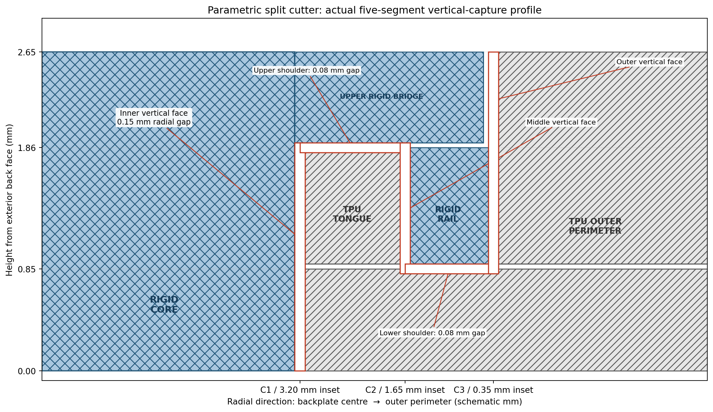
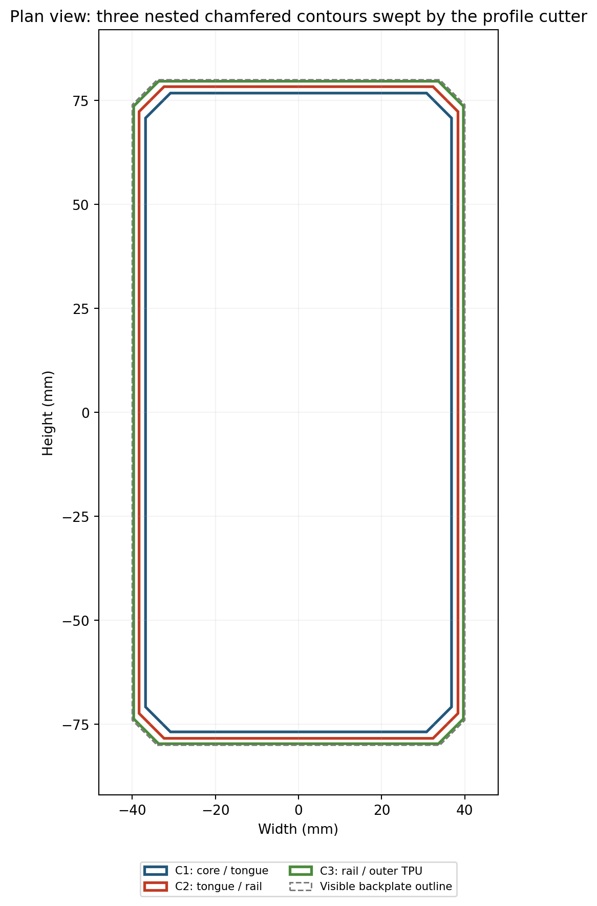

# Phone Case Strap

**A sliding finger grip and kickstand for almost any phone case.**

This is a universal system that turns almost any phone case into one with a
flexible holding strap that doubles as a kickstand. It's modelled on the strap
Samsung builds into its S25 Ultra case: flush with the back when stowed,
comfortable to hold one-handed, and a kickstand at two different angles when
deployed. It slides on rails cut into the case, clicks into a detent when open,
and stops before it can come out.

I struggle with CAD and really only know how to use a slicer, so the strap system
is built to need no CAD at all — route **A** below is two minutes in OpenSCAD and
your slicer. The perimeter cut (route C) is more involved, and I wouldn't bother
unless you want the swappable backplate. I used AI to make these files, and I'm
shipping an **agent pack** with them: hand your case to an AI agent and let it do
the measuring for you (route B).

Version 1.0 · millimetres · CC BY-NC-SA 4.0

---

## Three ways to use this

### A · Rigid case + strap — no CAD *(start here)*

Rescale the strap-housing negative volume, apply it to your case in the slicer as
a negative volume, print the matching strap in TPU. That's it.

Do it through the **SCAD parameters**, not by scaling the STL in the slicer — the
spring gap has to stay correct and scaling quietly breaks it. The strap file
reads the same parameters, so the two always match.

### B · Let an agent do it

There's an **Agent Pack** next to this kit and a copy of the whole project on
GitHub. Point an agent at the repository and give it your case: it measures the
case, finds the camera and sensor openings, works out where the housing fits
without cutting into them, drives the same SCAD files and hands back printable
parts. Useful when the case has awkward cutouts and you'd rather not measure.

### C · Flexible case → swappable rigid backplate

Cut the flat back panel out of a TPU case and rejoin it as a rigid plate that
hooks into the flexible perimeter. Good if you want to save TPU, mix colours or
make the case lighter. It's an **assembly**, so no multi-material printer is
needed.

The cut isn't a straight slit: it's a stepped profile that leaves the TPU
perimeter with a tongue trapped behind a rigid rail, so the halves hook into each
other instead of relying on friction. It needs a real 3D boolean — slicers can
apply the cutter but can't export the two halves. The backplate needs supports;
the supported face ends up hidden inside the case.

Do A and C together and you get all three: rigid backplate, TPU perimeter, TPU
strap.

---

## Print this

| part | material | |
|---|---|---|
| Strap | TPU, 95A or softer | flat, grooved face on the bed |
| Backplate | rigid — PETG, PETG-CF, ASA | spring beams need a stiff material |
| Perimeter | TPU | the flexible half of the hook joint |

**A full-TPU case does not work.** I printed and tested one: too flexible to hold
the slider. The backplate has to be rigid.

Print with a 0.4 mm nozzle at minimum; my reference runs 0.20 mm layers on a
0.6 mm nozzle. Print the parts separately — nothing here prints assembled.

### The one thing that bites everyone: the spring gap

The housing has a designed air gap under each spring beam so the beam can flex.
The default `spring_air_gap` is **0.20 mm**, which is what works on my 0.20 mm
layer / 0.6 mm nozzle profile. It is a starting point, not a guarantee.

**Don't rely on automatic variable layer height to find it.** That cavity exists
only in the negative-volume modifier, so the variable-height pass can miss it
entirely and you'll print a solid block where the spring should be. Set the value
in `strap_system_parameters.scad`, regenerate the modifier, and look at the
sliced toolpath around both springs.

The first layer of each free beam span has to bridge between its anchors without
fusing to the track floor. Don't put supports in the gap. If it fuses or sags,
raise the gap in small steps — 0.25, 0.30, 0.40 — regenerate and test. A bigger
gap lifts the beam and leaves it shorter, which softens the detent, so use the
smallest gap that prints free.

### Reference strap

| | |
|---|---:|
| Band | 143.50 × 16.60 × 2.60 mm |
| Ears | 6.40 mm wide × 1.85 mm thick |
| Ear length, fixed / moving end | 10.0 / 15.8 mm |
| Travel to detent | 33.0 mm |
| Extra travel to hard stop | ~0.20 mm |
| Underside flex grooves | 35 at 3.15 mm pitch |

The transverse grooves make the band bend where it should without letting it
twist. Ears narrower than this pull out of the track under load; wider ones stop
the housing fitting between the camera cutout and the case edge. 6.40 mm is where
those two limits meet on a large phone.

---

## Route A — the housing, step by step

`strap_housing_negative.scad` makes a negative volume you subtract from the
**phone-facing** side of a rigid rear panel. It cuts a window for the band, two
tracks with spring detents and a hard stop, sockets for the fixed ears, and the
spring reliefs.

The tracks stay **open toward the phone**; the phone closes them once it's in the
case. Don't add a roof.

**Datum:** X=0 is the band centreline, Y=0 the fixed end (+Y toward the moving
end), Z=0 the exterior back face (+Z into the phone). Offset the housing away
from the camera cluster — never centre it, or it eats the camera openings. On a
split backplate keep the outer **3.2 mm** clear: that's the hook joint's retaining
rail.

1. Import the rigid case into your slicer.
2. Add `Examples/strap_housing_negative.stl` as a **negative-volume modifier**,
   not a printable part.
3. Align the datum to where the strap should sit.
4. Check the window, sockets, tracks and reliefs cut only what they should.
5. Slice and inspect the spring undersides. The track floor and outer skin must
   both stay continuous.
6. Print the case rigid, the strap in TPU.

The reference panel is 2.65 mm thick with a 0.60 mm track floor. Not universal —
keep enough outer skin and spring material for your material and profile.

> The **Agent Pack** also ships an analytic variant with a **0.40 mm** gap, for
> subtracting the housing in CAD rather than a slicer. It is not interchangeable
> with the 0.20 mm modifier, and the softer spring that comes with it is real.

---

## Route B — handing it to an agent

Give the agent the repository (or the Agent Pack) and your case file. What it
needs to do, and what the pack tells it to do:

- measure the back panel — thickness, visible outline, where the flat area
  actually is;
- find every through-opening, so the housing can't land on a camera;
- place the housing offset to the camera-free side, springs toward the camera end
  (the top of the phone), clear of both the openings and the hook joint;
- drive `perimeter_split_negative.scad` and `strap_housing_negative.scad` with
  `-D` overrides rather than rebuilding the geometry itself, so the joint and the
  spring gap stay exactly as designed;
- regenerate the strap from the same parameters, and check the result is still
  one watertight part per piece.

It updates the parameters, not the geometry. If it ever offers you a case built
from hard-coded coordinates instead of measured ones, it has stopped reading the
pack.

---

## Route C — the perimeter splitter

`perimeter_split_negative.scad` generates the negative volume for the
backplate/perimeter interlock. It is not a straight vertical slit — it's a
five-segment stepped profile that leaves, at mid-height,
`RIGID CORE | TPU TONGUE | RIGID RETAINING RAIL | TPU OUTER PERIMETER`.

The TPU tongue stays attached to the perimeter below the rail, the rigid rail
stays attached to the backplate above the tongue. The vertical faces resist
pulling the case apart; the shoulders resist lifting it off.



### What you enter

| parameter | meaning |
|---|---|
| `split_boundary_width` | width of the **visible backplate outline**, mm |
| `split_boundary_height` | height of that outline, mm |
| `split_corner_chamfer` | chamfer leg along each straight edge, mm |
| `backplate_thickness` | exterior face to the phone-facing surface at the joint, mm |

That's the backplate outline, **not** the outside of the whole case. The cutter is
centred on X/Y; `base_z` is the exterior-back plane.



The rest has defaults taken from my accepted S25 joint — a starting point, not
universal: `joint_inner_inset` 3.20, `joint_middle_inset` 1.65,
`joint_outer_inset` 0.35 mm (the three boundaries), step heights 0.32 and 0.70 of
the thickness, `joint_radial_clearance` 0.15 mm at vertical faces,
`joint_vertical_clearance` 0.08 mm at the shoulders. Keep the insets in that
descending order; the SCAD asserts the basics.

### Export

```sh
# one connected ring (default)
openscad -D 'output_mode="all"' -o perimeter_cutter_full_ring.stl perimeter_split_negative.scad

# or straight runs and chamfer corners separately, for fussy boolean tools
openscad -D 'output_mode="straight"' -o perimeter_cutter_straight_edges.stl perimeter_split_negative.scad
openscad -D 'output_mode="corners"'  -o perimeter_cutter_chamfer_corners.stl perimeter_split_negative.scad
```

`all` gives one watertight ring. `straight` and `corners` give four separate
watertight pieces each and add up to the same volume. Subtract one or the other —
never the ring *and* the pieces.

### Apply it

1. Import the one-piece case into something that does a true 3D boolean
   difference — Blender, FreeCAD, Fusion. A slicer's split is not enough, though
   a slicer can apply the negative volume if you only want to preview.
2. Confirm millimetres, orientation and the exterior-back Z datum, then align the
   cutter's outline to the measured backplate.
3. Subtract. If your tool chokes on the ring, subtract `straight` and `corners`.
4. Extract the connected components. A test slab splits into exactly two
   watertight solids; a real case may have a local bridge that stops it. Look at
   the result instead of trusting it.
5. Backplate rigid, perimeter TPU — and add the housing to the backplate only if
   you want the strap.
6. Inspect sections along all four sides and every chamfer. Clean the supports out
   of the hidden undercut and check the tongue is captured behind the rail.

### What it will not do

It's a parametric chamfered-rectangle cutter. It does **not** inspect your STL,
find camera openings, measure wall thickness or route around buttons, ports and
existing rails. You measure; you check.

If the hook would cross a camera cutout, a thin wall, a button or an existing
rail, move the boundary or relieve the profile locally. My S25 joint needed a
local relief around a grip rail — the helper can't know that.

### One rule for changing anything

The strap and the housing both read `strap_system_parameters.scad`. Edit values
there, regenerate **both** outputs, and never scale one part in the slicer:

```sh
openscad -o strap_housing_negative.stl strap_housing_negative.scad
openscad -o strap.stl              strap_parametric.scad
```

Travel, strap length, ear positions or notch size all move both parts together.
`spring_air_gap` affects the housing only.

---

## Files

| file | what it is | print it? |
|---|---|---|
| `strap_system_parameters.scad` | every shared dimension — **edit this one** | — |
| `strap_parametric.scad` | generates the strap | — |
| `strap_housing_negative.scad` | generates the housing negative | — |
| `perimeter_split_negative.scad` | generates the perimeter split | — |
| `Examples/strap_TPU.stl` / `.step` | reference strap, print orientation | **TPU** |
| `Examples/backplate_rigid.stl` | worked example: rigid backplate, housing already cut | **rigid** |
| `Examples/perimeter_TPU.stl` | worked example: matching TPU perimeter | **TPU** |
| `Examples/strap_housing_negative.stl` | housing as a slicer modifier | no — modifier |
| `Examples/cutter/` | the three split-cutter exports | no — tool |
| `Diagrams/` | the figures in this document | — |
| `LICENSE` | full legal code | — |

The three parts in `Examples/` are a matched set, cut from the same parameters:
that strap fits that backplate. Print all three and they assemble and work. It's
an example of the finished result, not the only case you can build.

---

## If it goes wrong

| symptom | first thing to check |
|---|---|
| Spring doesn't move | beam fused to the floor — raise `spring_air_gap`, regenerate the modifier |
| Spring drags | bridge sag or too little gap; inspect the underside in preview |
| Passes the detent but won't stay open | notch position, nose size, spring stiffness |
| Ear runs out of the track | `track_hard_stop_overtravel` and moving-ear length — regenerate both parts |
| Strap binds or rubs | ear/track clearance and XY alignment; don't scale one part |
| Strap pulls out under load | ears too narrow, or the notch is too shallow for the nose |
| Perimeter stretches off the backplate | joint too shallow or no opposing vertical faces — don't fall back to a flat split or a friction wedge |

---

## Licence and credit

**CC BY-NC-SA 4.0** — <https://creativecommons.org/licenses/by-nc-sa/4.0/>. Full
legal code in `LICENSE`.

Print it, modify it, give it away, publish your remix — as long as you credit
**lunchtime** with a link back, say what you changed, and release what you
distribute under the same licence. **You may not sell prints or products made
from these files.**

The strap, housing, splitter and parameters are my own work. The worked example
in `Examples/` is a remix of a third-party case, credited in
`Examples/README.md` — which is why the release as a whole is non-commercial.

The reference case is
["S25 Ultra case with edge protection"](https://makerworld.com/en/models/1183966-s25-ultra-case-with-edge-protection)
by **Alex ([@alexm2901](https://makerworld.com/en/@alexm2901))**, used because it
permits remixing. My own case, not included here, is
[these S25 cases](https://www.printables.com/model/1166535-galaxy-s25-s25-plus-s25-ultra-s25-fe-cases-tpu-or)
by Victronix, whose licence doesn't allow redistribution.
