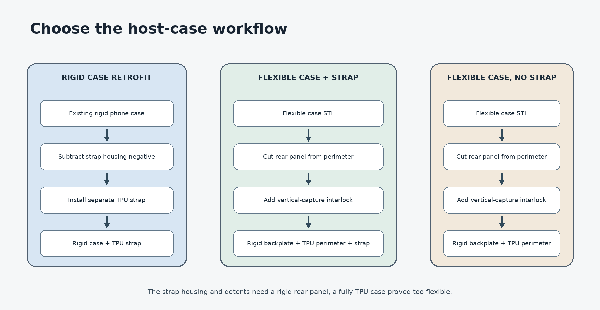

# Sliding strap / kickstand for phone cases

**Version 1.0 - first public release.**

A reusable TPU strap that slides between a nearly flush stowed position and a deployed kickstand / finger grip, plus the parametric tooling to install it in a case you already have. The mechanism is a rigid housing with phone-facing-open tracks, spring detents and hard stops; the phone itself closes the open side of the tracks once it is fitted.

The housing and its detents need a **rigid** rear panel. A fully TPU one-piece case was printed and tested: it is too flexible to retain the slider, which is why the flexible-case route keeps the outer perimeter in TPU and makes the backplate rigid.



## Start here

| If you want to... | Open |
|---|---|
| Print the strap and modify a rigid case | `Human_Kit/README.md`, or the PDF beside it |
| Split a flexible case and add the rigid backplate | `Human_Kit/README.md`, route C |
| Read the exact dimensions of the tested joint | `Agent_Pack/AGENT_HANDOFF.md` |
| Feed the CAD pipeline to an agent | `Agent_Pack/AGENTS.md`, then `AGENT_HANDOFF.md` |

## What is in here

**`Human_Kit/`** - printable, case-independent, and deliberately flat: one guide,
the SCAD sources, the diagrams, the examples.

- `README.md` and `Reusable_Strap_Kickstand_Guide.pdf` - the same guide in two forms
- `strap_system_parameters.scad`, `strap_parametric.scad`, `strap_housing_negative.scad`, `perimeter_split_negative.scad` - the four parametric sources
- `Examples/` - the printable set: reference strap (STL/STEP), a worked rigid backplate and matching TPU perimeter, the housing negative, and the three cutter exports
- `Diagrams/` - the figures used in the guide
- `LICENSE` - the legal code

**`Agent_Pack/`** - the autonomous workflow and the Galaxy S25 Ultra worked example

- `agent/agent.py` - measures a case, fits the split ring, drives the Human Kit's SCAD files, splits the case and cuts the strap housing. Standard library Python plus OpenSCAD.
- `reference/case/` - the licensed reference case the example is built on (CC BY-NC-SA 4.0, by Alex)
- `examples/s25-ultra-thik/` - one complete agent run: perimeter, backplate with tracks, and every number it measured
- `modules/` - analytic B-rep-safe housing negative for CAD booleans
- `AGENTS.md`, `AGENT_HANDOFF.md`, `project_context.json`, `agent/README.md` - the hand-off

## Three spring-gap values, three different models

Never treat these as interchangeable. Each belongs to a different artefact and workflow:

| Gap | Where it lives |
|---|---|
| **0.10 mm** | Integrated into the accepted S25 backplate and physically tested with it |
| **0.20 mm** | Human Kit slicer-modifier default, confirmed on a 0.20 mm layer / 0.6 mm nozzle profile |
| **0.40 mm** | Agent Pack analytic CAD negative, a deliberately conservative two-layer option |

Automatic variable layer height can ignore geometry that exists only inside a negative-volume modifier. Set the gap in the SCAD, regenerate, and inspect the bridge path.

## This is a non-commercial remix, and why

The Agent Pack's worked example is built on **"S25 Ultra case with edge protection" by Alex** ([@alexm2901](https://makerworld.com/en/@alexm2901)), used under [CC BY-NC-SA 4.0](https://creativecommons.org/licenses/by-nc-sa/4.0/). The original case is included in `Agent_Pack/reference/case/` with full attribution, and the parts generated from it are a remix under the same licence.

Because that source licence is NonCommercial, **this entire release is non-commercial**. The Human Kit on its own would not have to be, but the pack ships together and the derived geometry cannot be relicensed more permissively than its source.

What was changed: two zero-length non-manifold edges were collapsed so the mesh could be processed; the back panel was split from the perimeter with the parametric five-segment cutter; and a sliding strap housing was subtracted from the backplate. The original design was not otherwise altered.

Credit **Alex (@alexm2901)** for the case geometry, and **lunchtime** for the strap system, the split profile, the housing and the agent.

## Verifying a download

Each package carries a manifest. From inside the package folder:

```sh
sha256sum -c MANIFEST.sha256
```

`Agent_Pack/MANIFEST.json` is the same inventory in machine-readable form (path, size, SHA-256), excluding both manifest files because a manifest cannot contain its own hash.

## Printing

- **Strap:** TPU, with the grooved underside on the build plate. Keep the grooves open at the first layer.
- **Rigid parts:** rigid filament; the accepted build used PETG-CF.
- Print the three parts of the flexible-case route separately. The Agent Pack's compound files are for inspection - never print one as a solid.
- The 0.15 mm joint clearances in the interlock are intentionally tight. Real clearance depends on printer, filament and slicer flow: inspect the sliced preview and test-fit before committing to a full case.
- Clean supports out of the track channel thoroughly before assembly, and do not force a rigid rail through a partially obstructed channel.

## Licence

Released under **Creative Commons Attribution-NonCommercial-ShareAlike 4.0 International (CC BY-NC-SA 4.0)**. Full legal code in [`LICENSE`](LICENSE) and in each package folder.

| | Term |
|---|---|
| ✖ | Sharing without ATTRIBUTION |
| ✔ | Remix Culture allowed |
| ✖ | Commercial Use |
| ✖ | Free Cultural Works |
| ✖ | Meets Open Definition |

You may print, modify and redistribute these files for **non-commercial** purposes, provided you credit **lunchtime**, link to the licence, state what you changed, and publish the derivative files you redistribute under the same CC BY-NC-SA 4.0 terms. Selling prints or products made from these files is not permitted.

Compatibility names are used descriptively. This is an independent accessory design; it is not affiliated with or endorsed by any phone or case manufacturer.

## Changelog and history

- `Agent_Pack/CHANGELOG.md` - what changed and why
- `Agent_Pack/AUDIT_REPORT.md` - what was actually validated, and how
